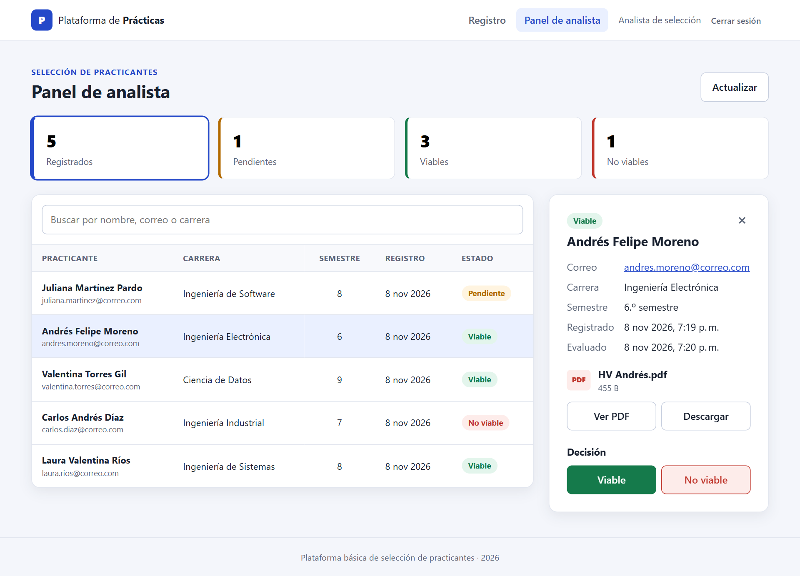
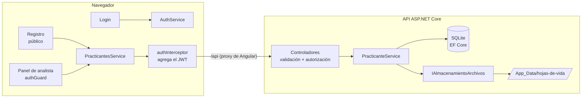
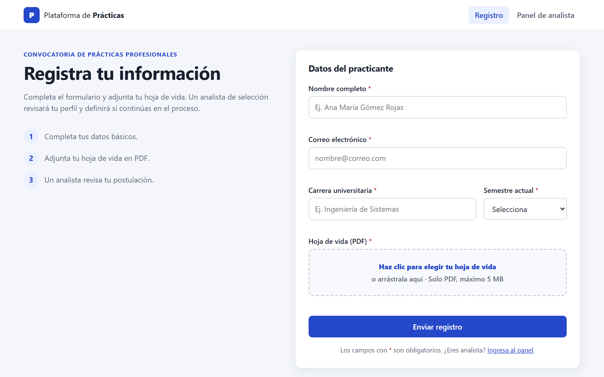
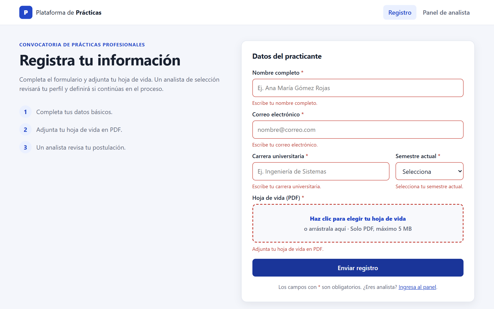
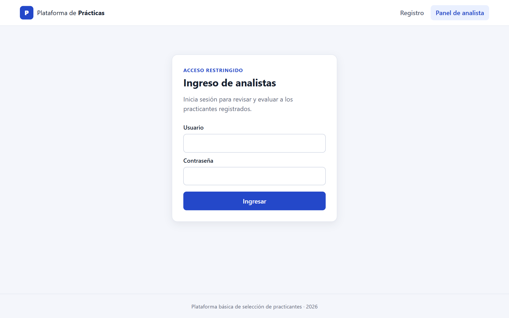
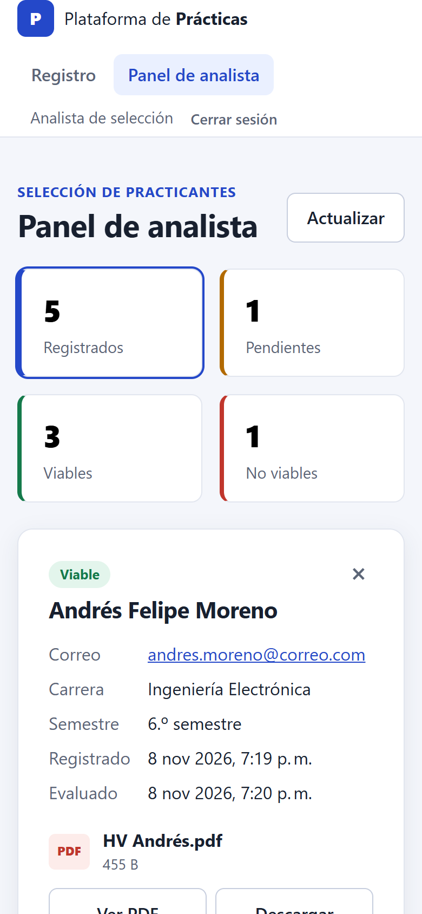

# Plataforma de prácticas · Sebastián Pineda

Solución al reto **Kata Practicing – Challenge 1: Plataforma Básica de Selección de Practicantes**.

Es una herramienta web con dos partes:

- **Registro de practicantes** (público): un formulario donde el candidato deja sus datos y adjunta su hoja de vida en PDF.
- **Panel de analista** (con inicio de sesión): el analista de selección ve la lista de practicantes, revisa la información de cada uno, abre o descarga su hoja de vida y lo marca como **Viable** o **No viable**.



---

## Contenido

- [El reto y cómo se cubre](#el-reto-y-cómo-se-cubre)
- [Tecnologías](#tecnologías)
- [Cómo ejecutarlo](#cómo-ejecutarlo)
- [Pruebas](#pruebas)
- [API](#api)
- [Arquitectura](#arquitectura)
- [Decisiones de diseño](#decisiones-de-diseño)
- [Capturas de pantalla](#capturas-de-pantalla)
- [Posibles mejoras](#posibles-mejoras)

---

## El reto y cómo se cubre

| Requisito del reto | Implementación |
| --- | --- |
| Formulario con nombre completo, correo, carrera y semestre | `frontend/src/app/features/registro` (formulario reactivo de Angular) |
| Subir la hoja de vida en PDF | Selector de archivo con arrastrar y soltar; solo PDF y hasta 5 MB |
| Verificación de campos obligatorios | Validación en el navegador (mensajes por campo) **y** en la API (DataAnnotations + validador propio del PDF) |
| Panel: listar practicantes registrados | `features/analista/panel`, con contadores por estado, filtros y búsqueda |
| Panel: ver la información de cada practicante | Panel lateral de detalle al seleccionar una fila |
| Botón para marcar "Viable" / "No viable" | Botones de decisión; el cambio se guarda en la API y se refleja al instante |
| API: guardar practicante | `POST /api/practicantes` (multipart/form-data) |
| API: consultar la lista | `GET /api/practicantes` (filtro opcional por estado y texto) |
| API: actualizar el estado | `PATCH /api/practicantes/{id}/estado` |
| Base de datos local | SQLite con Entity Framework Core y migraciones |
| Almacenar archivos en una carpeta del servidor | `backend/src/Practicas.Api/App_Data/hojas-de-vida` (configurable) |
| README con instalación, ejecución y capturas | Este archivo |
| **Opcional:** autenticación básica de analistas | Usuario y contraseña → token JWT; el panel y los endpoints del analista están protegidos |
| **Opcional:** descarga de la hoja de vida | Botones **Ver PDF** y **Descargar** en el detalle del practicante |

Además de lo pedido: pruebas automatizadas en backend y frontend, manejo de errores con `ProblemDetails`, correo único por practicante, diseño adaptable a móvil y accesibilidad básica (etiquetas, `aria-*`, foco en el primer campo con error).

## Tecnologías

| Capa | Tecnología |
| --- | --- |
| Backend | **.NET 10**, ASP.NET Core Web API (controladores), Entity Framework Core 10, SQLite |
| Autenticación | JWT Bearer (`Microsoft.AspNetCore.Authentication.JwtBearer`) |
| Frontend | **Angular 22** (componentes standalone, signals, formularios reactivos, sin zone.js), TypeScript, CSS |
| Pruebas | xUnit + `WebApplicationFactory` (backend), Vitest + `TestBed` (frontend) |

El reto permite cualquier lenguaje o framework. Elegí C#/ASP.NET Core y Angular/TypeScript porque son el stack con el que más he trabajado y permiten tipado de punta a punta.

## Cómo ejecutarlo

### Requisitos previos

- [.NET SDK 10](https://dotnet.microsoft.com/download)
- [Node.js 22 o superior](https://nodejs.org/) con npm
- No hace falta instalar una base de datos: SQLite se crea sola al iniciar la API.

### 1. Clonar el repositorio

```bash
git clone https://github.com/Semiramyz/plataforma-practicas-sebastian-pineda.git
cd plataforma-practicas-sebastian-pineda
```

### 2. Levantar la API (terminal 1)

```bash
dotnet run --project backend/src/Practicas.Api --launch-profile http
```

La API queda en `http://localhost:5080`. Al arrancar aplica las migraciones y crea `App_Data/practicas.db`. Para comprobar que está arriba: `http://localhost:5080/api/salud`. En desarrollo, el documento OpenAPI está en `http://localhost:5080/openapi/v1.json`.

### 3. Levantar el frontend (terminal 2)

```bash
cd frontend
npm install
npm start
```

Abre **http://localhost:4200**. El servidor de Angular redirige las llamadas `/api` hacia la API mediante `proxy.conf.json`, así que no hay que configurar CORS ni URLs.

### 4. Usar la aplicación

- **Registro:** `http://localhost:4200/registro`
- **Panel de analista:** `http://localhost:4200/analista`, con las credenciales de desarrollo:

| Usuario | Contraseña |
| --- | --- |
| `analista` | `Seleccion2026*` |

Estas credenciales y la clave de firma del JWT están solo en `appsettings.Development.json`, pensadas para la demo local. En `appsettings.json` (producción) están vacías y la API no arranca si no se configuran.

### Configuración

Todo se puede cambiar en `backend/src/Practicas.Api/appsettings*.json` o con variables de entorno (`__` separa secciones):

| Clave | Por defecto | Descripción |
| --- | --- | --- |
| `ConnectionStrings:Practicas` | `Data Source=App_Data/practicas.db` | Ruta de la base SQLite (relativa al proyecto de la API) |
| `Almacenamiento:RutaHojasDeVida` | `App_Data/hojas-de-vida` | Carpeta donde se guardan los PDF |
| `Almacenamiento:TamanoMaximoBytes` | `5242880` (5 MB) | Tamaño máximo de la hoja de vida |
| `Autenticacion:Analista:Usuario` / `Contrasena` | (solo en Development) | Credenciales del analista |
| `Autenticacion:ClaveFirma` | (solo en Development) | Clave para firmar los JWT (mínimo 32 caracteres) |
| `Cors:OrigenesPermitidos` | `http://localhost:4200` | Orígenes permitidos si el frontend se sirve sin proxy |

> **Nota para Windows:** si está activado *Acceso controlado a carpetas* (protección contra ransomware) y el proyecto está dentro de `Documentos`, Windows puede impedir que la API cree `App_Data`. En ese caso, permite la aplicación en la configuración de seguridad o apunta los datos a otra carpeta:
>
> ```powershell
> $env:ConnectionStrings__Practicas = "Data Source=C:\temp\practicas\practicas.db"
> $env:Almacenamiento__RutaHojasDeVida = "C:\temp\practicas\hojas-de-vida"
> dotnet run --project backend/src/Practicas.Api --launch-profile http
> ```

## Pruebas

```bash
# Backend: 36 pruebas (unitarias + integración de la API completa)
dotnet test backend

# Frontend: 18 pruebas (componentes, validadores e interceptor)
cd frontend
npm test -- --watch=false
```

**Backend** (`backend/tests/Practicas.Api.Tests`):

- *Unitarias*: reglas del dominio (`Practicante.Evaluar`) y validación del PDF (extensión, firma `%PDF-`, tamaño, archivo vacío).
- *Integración*: levantan la API real en memoria con `WebApplicationFactory`, una base SQLite y una carpeta temporales por prueba. Cubren registro válido, cada campo inválido, PDF falso o demasiado grande, correo duplicado (409), endpoints protegidos sin token (401), credenciales erróneas, listado y filtros, cambio de estado, estados no permitidos (400), recursos inexistentes (404) y la descarga del PDF con su nombre original.

**Frontend** (`*.spec.ts`):

- Formulario de registro: errores de obligatorios, nombre con solo espacios, correo inválido, archivo que no es PDF, envío como `multipart/form-data` y mensaje del servidor cuando el correo ya existe.
- Panel: listado y contadores, filtros por estado y búsqueda sin tildes, marcar Viable / No viable.
- Interceptor: adjunta el token y cierra la sesión ante un 401.

## API

| Método | Ruta | Acceso | Descripción |
| --- | --- | --- | --- |
| `POST` | `/api/practicantes` | Público | Registra un practicante (`multipart/form-data`: `nombreCompleto`, `correo`, `carrera`, `semestre`, `hojaDeVida`). Responde `201`, `400` o `409`. |
| `POST` | `/api/auth/login` | Público | `{ "usuario", "contrasena" }` → `{ token, expiraUtc, nombre }`. Responde `401` si las credenciales no son válidas. |
| `GET` | `/api/practicantes?estado=&busqueda=` | Analista | Lista de practicantes (más recientes primero). `estado`: `Pendiente`, `Viable` o `NoViable`. |
| `GET` | `/api/practicantes/{id}` | Analista | Detalle de un practicante. |
| `PATCH` | `/api/practicantes/{id}/estado` | Analista | `{ "estado": "Viable" }` o `{ "estado": "NoViable" }`. |
| `GET` | `/api/practicantes/{id}/hoja-de-vida` | Analista | Descarga el PDF con su nombre original. |
| `GET` | `/api/salud` | Público | Comprobación de que la API está en ejecución. |

Los errores se devuelven como [`ProblemDetails` (RFC 9457)](https://www.rfc-editor.org/rfc/rfc9457), con los mensajes de validación por campo en español.

Ejemplo con `curl`:

```bash
curl -X POST http://localhost:5080/api/practicantes \
  -F "nombreCompleto=Ana María Gómez" \
  -F "correo=ana.gomez@correo.com" \
  -F "carrera=Ingeniería de Sistemas" \
  -F "semestre=8" \
  -F "hojaDeVida=@hoja-de-vida.pdf;type=application/pdf"
```

## Arquitectura



### Estructura del repositorio

```
├── backend/
│   ├── Practicas.slnx
│   ├── src/Practicas.Api/
│   │   ├── Auth/            # Inicio de sesión y emisión del JWT
│   │   ├── Contracts/       # DTOs de entrada y salida
│   │   ├── Controllers/     # Endpoints HTTP (delgados)
│   │   ├── Data/            # DbContext, conversores y migraciones
│   │   ├── Domain/          # Entidad Practicante y su estado
│   │   ├── Errors/          # Excepciones de dominio → ProblemDetails
│   │   ├── Options/         # Configuración tipada y validada al iniciar
│   │   ├── Services/        # Lógica de negocio
│   │   ├── Storage/         # Guardado de archivos en disco
│   │   ├── Validation/      # Validador del PDF
│   │   └── Program.cs       # Composición de dependencias y pipeline
│   └── tests/Practicas.Api.Tests/
│       ├── Integracion/     # Pruebas contra la API completa
│       └── Unitarias/
├── frontend/
│   ├── proxy.conf.json      # /api → http://localhost:5080
│   └── src/app/
│       ├── core/            # Modelos, servicios, auth (guard + interceptor), validadores
│       └── features/
│           ├── registro/    # Formulario del practicante
│           └── analista/    # Login y panel
└── docs/capturas/
```

## Decisiones de diseño

- **Capas dentro de un solo proyecto de API.** Para el tamaño del reto, separar en varios proyectos (Domain, Application, Infrastructure) agregaría ceremonia sin beneficio. Las responsabilidades están separadas por carpetas e interfaces (`IPracticanteService`, `IAlmacenamientoArchivos`), así que dividirlo después es directo.
- **Controladores delgados, lógica en servicios.** Los controladores solo traducen HTTP; la normalización de datos, el control de duplicados y el guardado del archivo están en `PracticanteService`.
- **El dominio protege sus reglas.** `Practicante.Estado` tiene `private set` y solo cambia con `Evaluar()`, que no permite volver a `Pendiente`. La API también restringe los valores con `[AllowedValues]`.
- **Validación en las dos capas.** El frontend valida para dar respuesta inmediata; la API vuelve a validar porque es la fuente de verdad. El PDF se verifica por extensión **y** por su firma `%PDF-`, de modo que un archivo renombrado no pasa.
- **Archivos con nombre generado.** Los PDF se guardan como `{GUID}.pdf`; el nombre original solo se guarda en la base de datos para la descarga. Así se evitan colisiones y ataques de *path traversal*. Si la base de datos falla al registrar, el archivo se elimina para no dejar huérfanos.
- **Correo único.** Se normaliza (minúsculas, sin espacios) y tiene índice único en la base de datos; un segundo registro con el mismo correo responde `409 Conflict`, también si dos llegan a la vez.
- **SQLite + EF Core con migraciones.** Cumple el requisito de base de datos local sin instalar nada y permite cambiar a PostgreSQL o SQL Server cambiando el proveedor. Las fechas se guardan en UTC y se devuelven marcadas como UTC para que el navegador las muestre en hora local.
- **JWT para la autenticación básica.** El reto pide usuario y contraseña simples. Usar JWT permite proteger los endpoints con `[Authorize(Roles = "Analista")]` sin sesiones en el servidor. La comparación de credenciales es de tiempo constante y las credenciales viven en configuración, no en el código.
- **Errores homogéneos.** Un `IExceptionHandler` convierte las excepciones de dominio en `ProblemDetails` y oculta los detalles internos de los errores inesperados.
- **Configuración tipada y validada al iniciar** (`ValidateOnStart`): si falta la clave del JWT o las credenciales, la API falla al arrancar en vez de fallar en la primera petición.
- **Angular moderno.** Componentes standalone con carga diferida por ruta, *signals* para el estado, formularios reactivos tipados, `@if`/`@for` y sin zone.js. El proxy de desarrollo evita configurar URLs o CORS.
- **Sesión en `sessionStorage`.** La sesión del analista termina al cerrar la pestaña, y el interceptor cierra la sesión y redirige al login si el token expiró.
- **Sin librerías de UI.** Para una herramienta sencilla, unos estilos propios con variables CSS son suficientes y mantienen el bundle pequeño (unos 80 kB comprimidos).

## Capturas de pantalla

| Formulario de registro | Validación de campos obligatorios |
| --- | --- |
|  |  |

| Ingreso de analistas | Panel en móvil |
| --- | --- |
|  |  |

## Posibles mejoras

- Gestión de varios analistas con contraseñas con hash (ASP.NET Core Identity) y registro de quién tomó cada decisión.
- Comentarios del analista y notificación por correo al practicante.
- Paginación en el servidor cuando el volumen de registros crezca.
- Guardar los archivos en un almacenamiento de objetos (Azure Blob Storage, S3) implementando `IAlmacenamientoArchivos`.
- Contenedores Docker y un pipeline de CI que ejecute las pruebas.

---

Desarrollado por **Juan Sebastián Pineda Santafé** · Ingeniería de Sistemas, Universidad El Bosque.
