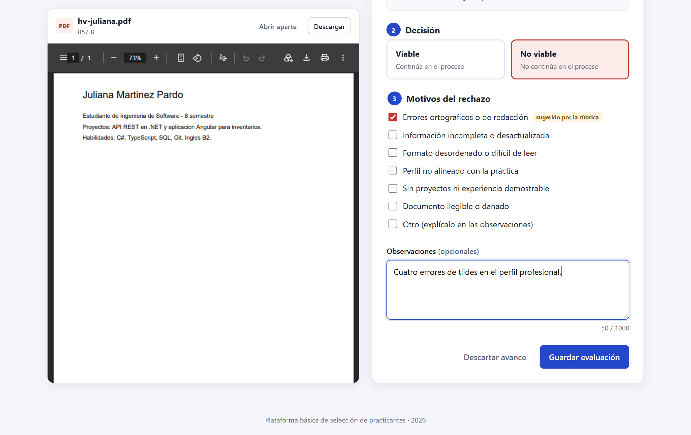
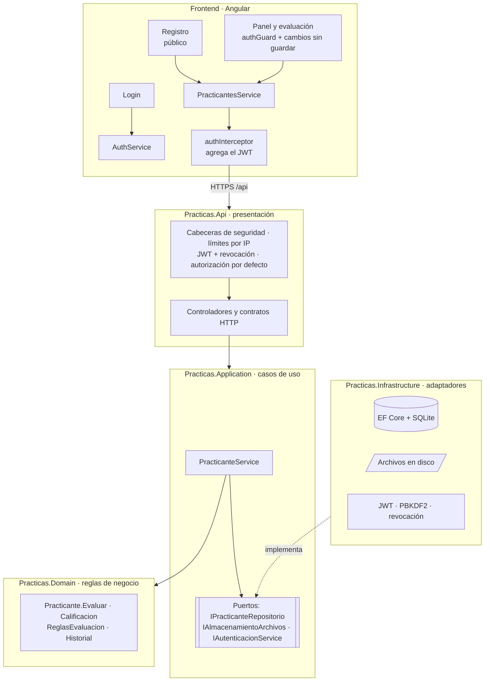
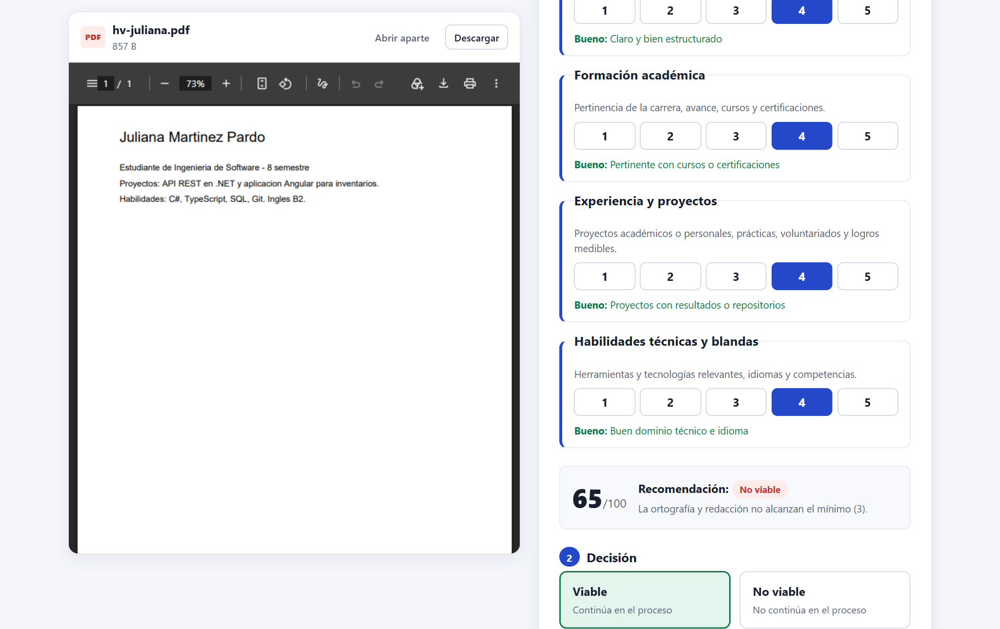
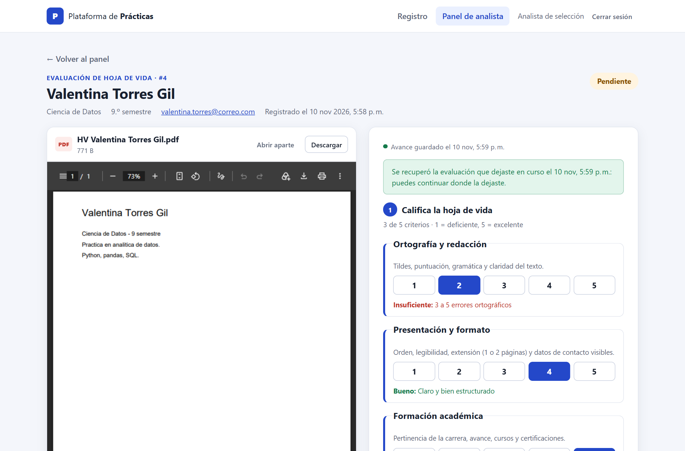
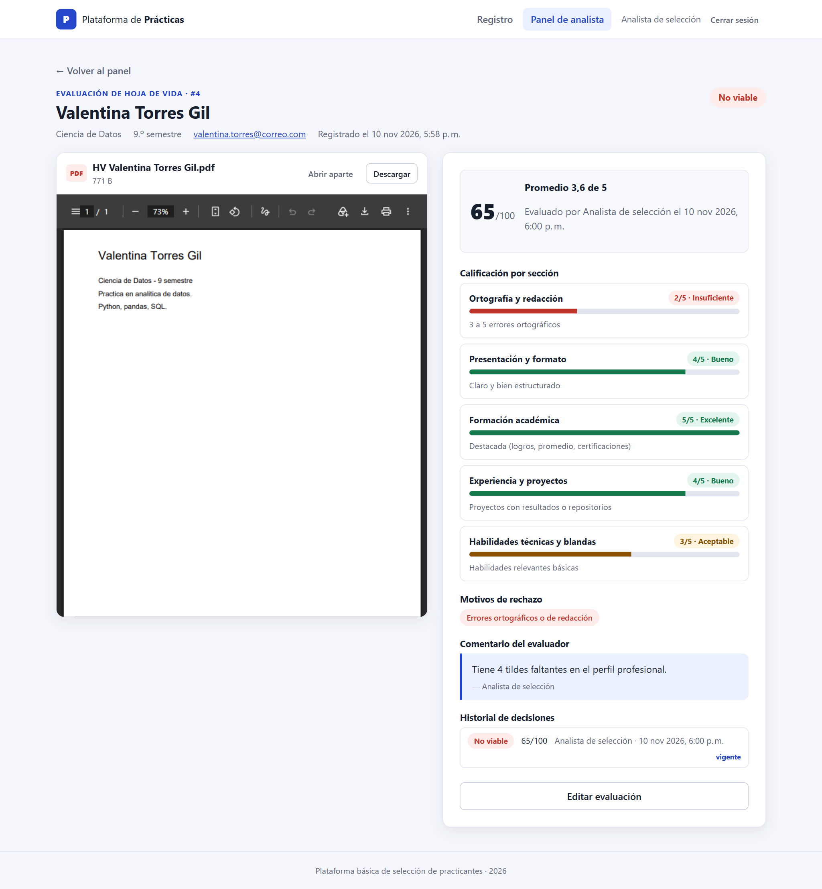
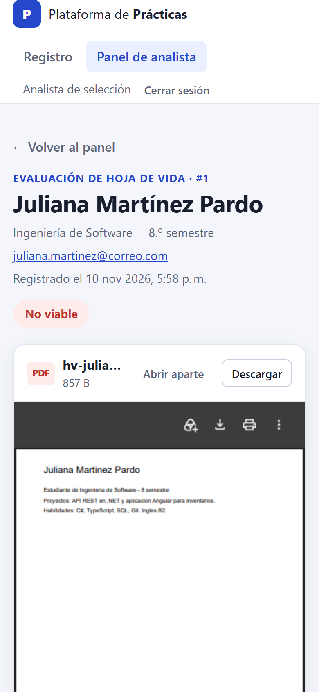

# Plataforma de prácticas · Sebastián Pineda

Solución al reto **Kata Practicing – Challenge 1: Plataforma Básica de Selección de Practicantes**.

Es una herramienta web con dos partes:

- **Registro de practicantes** (público): un formulario donde el candidato deja sus datos y adjunta su hoja de vida en PDF.
- **Panel de analista** (con inicio de sesión): el analista de selección ve la lista de practicantes, abre la hoja de vida en un visor integrado, la **califica con una rúbrica de estándares de calidad** (ortografía, presentación, formación, experiencia y habilidades) y decide si es **Viable** o **No viable**, con motivos y observaciones.



---

## Contenido

- [El reto y cómo se cubre](#el-reto-y-cómo-se-cubre)
- [Tecnologías](#tecnologías)
- [Cómo ejecutarlo](#cómo-ejecutarlo)
- [Evaluación con rúbrica de calidad](#evaluación-con-rúbrica-de-calidad)
- [Seguridad](#seguridad)
- [Calidad y accesibilidad](#calidad-y-accesibilidad)
- [Pruebas](#pruebas)
- [API](#api)
- [Arquitectura](#arquitectura)
- [Decisiones de diseño](#decisiones-de-diseño)
- [Capturas de pantalla](#capturas-de-pantalla)
- [Posibles mejoras](#posibles-mejoras)

---

## El reto y cómo se cubre

| Requisito del reto | Implementación |
| --- | --- |
| Formulario con nombre completo, correo, carrera y semestre | `frontend/src/app/features/registro` (formulario reactivo de Angular) |
| Subir la hoja de vida en PDF | Selector de archivo con arrastrar y soltar; solo PDF y hasta 5 MB |
| Verificación de campos obligatorios | Validación en el navegador (mensajes por campo) **y** en la API: nombre y apellido solo con letras, correo con dominio, PDF real y autorización de datos |
| Panel: listar practicantes registrados | `features/analista/panel`, con contadores por estado, filtros, búsqueda, orden y puntaje |
| Panel: ver la información de cada practicante | Pantalla de evaluación con los datos del practicante y su hoja de vida en un visor integrado |
| Botón para marcar "Viable" / "No viable" | Decisión respaldada por una rúbrica de calidad: no se puede decidir sin calificarla, y "No viable" exige motivos |
| API: guardar practicante | `POST /api/practicantes` (multipart/form-data) |
| API: consultar la lista | `GET /api/practicantes` (filtro opcional por estado y texto) |
| API: actualizar el estado | `PUT /api/practicantes/{id}/evaluacion` (rúbrica + decisión + motivos) |
| Base de datos local | SQLite con Entity Framework Core y migraciones |
| Almacenar archivos en una carpeta del servidor | `backend/src/Practicas.Api/App_Data/hojas-de-vida` (configurable) |
| README con instalación, ejecución y capturas | Este archivo |
| **Opcional:** autenticación básica de analistas | Usuario y contraseña (guardada como hash PBKDF2) → token JWT; las rutas y los endpoints del analista están protegidos |
| **Opcional:** descarga de la hoja de vida | Visor integrado y botones **Abrir aparte** y **Descargar** |

Además de lo pedido: rúbrica de calidad con puntaje y recomendación automática, endurecimiento de seguridad (ver [Seguridad](#seguridad)), pruebas automatizadas en backend, frontend y de punta a punta, manejo de errores con `ProblemDetails`, correo único por practicante, diseño adaptable a móvil y accesibilidad básica (etiquetas, `aria-*`, foco en el primer campo con error).

## Tecnologías

| Capa | Tecnología |
| --- | --- |
| Backend | **.NET 10**, ASP.NET Core Web API (controladores), Entity Framework Core 10, SQLite. **Clean Architecture** en cuatro proyectos |
| Autenticación | JWT Bearer (`Microsoft.AspNetCore.Authentication.JwtBearer`) |
| Frontend | **Angular 22** (componentes standalone, signals, formularios reactivos, sin zone.js), TypeScript, CSS |
| Pruebas | xUnit + `WebApplicationFactory` (backend), Vitest + `TestBed` (frontend), Puppeteer + axe-core (punta a punta y accesibilidad) |
| Calidad | Analizadores de .NET (`latest-recommended`, advertencias como errores), ESLint con `angular-eslint` (incluye accesibilidad), Prettier, GitHub Actions y Dependabot |

El reto permite cualquier lenguaje o framework. Elegí C#/ASP.NET Core y Angular/TypeScript porque son el stack con el que más he trabajado y permiten tipado de punta a punta.

## Cómo ejecutarlo

Hay tres formas. Para probar la aplicación, la **opción A** es la más rápida.

| Opción | Necesitas | Comando | Cuándo usarla |
| --- | --- | --- | --- |
| **A. Un solo comando** | .NET 10 + Node 22 | `.\iniciar.cmd` (Windows) o `./iniciar.sh` (Mac/Linux) | Probar la aplicación en cualquier equipo |
| **B. Docker** | Docker Desktop | `docker compose up --build` | El equipo no tiene .NET ni Node |
| **C. Modo desarrollo** | .NET 10 + Node 22 | Dos terminales (API + `ng serve`) | Modificar el código con recarga en caliente |

En las tres, la aplicación queda en **http://localhost:5080** (opciones A y B) o **http://localhost:4200** (opción C), con estas credenciales de analista:

| Usuario | Contraseña |
| --- | --- |
| `analista` | `Seleccion2026*` |

No hace falta instalar una base de datos: SQLite se crea sola al iniciar la API.

```bash
git clone https://github.com/Semiramyz/plataforma-practicas-sebastian-pineda.git
cd plataforma-practicas-sebastian-pineda
```

### A. Un solo comando

**Windows:** doble clic en `iniciar.cmd`, o desde una terminal:

```powershell
.\iniciar.cmd
```

En PowerShell el `.\` es obligatorio: PowerShell no ejecuta archivos de la carpeta actual si no se indica la ruta. En `cmd.exe` funciona con o sin él.

**macOS / Linux:**

```bash
chmod +x iniciar.sh   # solo la primera vez
./iniciar.sh
```

El script comprueba que tengas .NET 10 y Node 22, compila el frontend y la API y arranca **un solo servidor** en `http://localhost:5080` que sirve las dos partes. Cuando termina de arrancar abre el navegador. Para detenerlo, pulsa `Ctrl+C`.

- La primera vez tarda unos minutos porque instala las dependencias de npm. Las siguientes veces es mucho más rápido.
- Todo lo que genera (compilación, `node_modules`, base de datos y hojas de vida) lo guarda **fuera del proyecto**: en `%LOCALAPPDATA%\PlataformaPracticas` en Windows y en `~/.cache/plataforma-practicas` en Mac/Linux. Por eso funciona aunque el proyecto esté en `Documentos` con la protección contra ransomware de Windows activada.
- Opciones: `.\iniciar.cmd -Puerto 8080`, `-SinNavegador` o `-Reiniciar` (borra los datos y empieza desde cero). En Mac/Linux: `PUERTO=8080 ./iniciar.sh` y `./iniciar.sh --reiniciar`.

### B. Docker

Solo necesitas [Docker Desktop](https://www.docker.com/products/docker-desktop/):

```bash
docker compose up --build
```

Abre `http://localhost:5080`. Los datos se guardan en el volumen `datos` y se conservan entre reinicios. Para borrarlos: `docker compose down -v`.

### C. Modo desarrollo (dos terminales)

Con este modo, el frontend se recarga solo al guardar cambios.

#### 1. Levantar la API (terminal 1)

```bash
dotnet run --project backend/src/Practicas.Api --launch-profile http
```

La API queda en `http://localhost:5080`. Al arrancar aplica las migraciones y crea `App_Data/practicas.db`. Para comprobar que está arriba: `http://localhost:5080/api/salud`. En desarrollo, el documento OpenAPI está en `http://localhost:5080/openapi/v1.json`.

#### 2. Levantar el frontend (terminal 2)

```bash
cd frontend
npm install
npm start
```

Abre **http://localhost:4200**. El servidor de Angular redirige las llamadas `/api` hacia la API mediante `proxy.conf.json`, así que no hay que configurar CORS ni URLs.

#### 3. Usar la aplicación

- **Registro:** `http://localhost:4200/registro`
- **Panel de analista:** `http://localhost:4200/analista`

Las credenciales de analista y la clave de firma del JWT están solo en `appsettings.Development.json`, pensadas para la demo local. La contraseña no se guarda: se guarda su hash PBKDF2. En `appsettings.json` (producción) están vacías y la API no arranca si no se configuran. Para usar otra contraseña, genera su hash y ponlo en `Autenticacion:Analista:ContrasenaHash`:

```bash
dotnet run --project backend/src/Practicas.Api -- --generar-hash "MiNuevaContraseña"
```

### Configuración

Todo se puede cambiar en `backend/src/Practicas.Api/appsettings*.json` o con variables de entorno (`__` separa secciones):

| Clave | Por defecto | Descripción |
| --- | --- | --- |
| `ConnectionStrings:Practicas` | `Data Source=App_Data/practicas.db` | Ruta de la base SQLite (relativa al proyecto de la API) |
| `Almacenamiento:RutaHojasDeVida` | `App_Data/hojas-de-vida` | Carpeta donde se guardan los PDF |
| `Almacenamiento:TamanoMaximoBytes` | `5242880` (5 MB) | Tamaño máximo de la hoja de vida |
| `Autenticacion:Analista:Usuario` / `ContrasenaHash` | (solo en Development) | Usuario y hash PBKDF2 de la contraseña del analista |
| `Autenticacion:ClaveFirma` | (solo en Development) | Clave para firmar los JWT (mínimo 32 caracteres) |
| `Autenticacion:MinutosExpiracion` | `60` | Duración de la sesión del analista |
| `LimitesSolicitudes:IntentosLogin` / `MinutosVentanaLogin` | `5` / `5` | Intentos de inicio de sesión permitidos por IP en cada ventana |
| `LimitesSolicitudes:RegistrosPorVentana` / `MinutosVentanaRegistro` | `10` / `60` | Registros de practicantes permitidos por IP en cada ventana |
| `Cors:OrigenesPermitidos` | `http://localhost:4200` | Orígenes permitidos si el frontend se sirve sin proxy |
| `Frontend:Ruta` | (vacío) | Carpeta del frontend compilado (`ng build`). Si se configura, la API también sirve la aplicación web en el mismo puerto (así funcionan las opciones A y B). |

### Si no arranca

| Síntoma | Causa | Solución |
| --- | --- | --- |
| `Could not find file '...obj\...sourcelink.json'` o `Access to the path '...obj\...' is denied` | *Acceso controlado a carpetas* de Windows (protección contra ransomware) con el proyecto en `Documentos` o `Escritorio`: no deja que `dotnet` y `node` escriban ahí | Usa la **opción A**, que compila fuera del proyecto. Otra alternativa: en *Seguridad de Windows → Protección contra ransomware → Permitir una aplicación*, agrega `C:\Program Files\dotnet\dotnet.exe` y `C:\Program Files\nodejs\node.exe`. También puedes clonar el proyecto en una carpeta como `C:\dev` |
| `No se encontró .NET` / `Se necesita el SDK de .NET 10` | Falta el SDK o es una versión anterior | Instala el [SDK de .NET 10](https://dotnet.microsoft.com/download). `dotnet --list-sdks` debe mostrar una versión `10.x` |
| `No se encontró Node.js` / `Se necesita Node.js 22` | Falta Node o es una versión anterior | Instala [Node.js 22 o superior](https://nodejs.org/) |
| `El puerto 5080 ya está en uso` | Otra instancia de la API (u otro programa) usa el puerto | Ciérrala o usa otro puerto: `.\iniciar.cmd -Puerto 8080` |
| `El término 'iniciar.cmd' no se reconoce como nombre de un cmdlet...` | En PowerShell se escribió `iniciar.cmd` sin `.\`: PowerShell no busca comandos en la carpeta actual | Escribe `.\iniciar.cmd` (o haz doble clic en el archivo desde el Explorador) |
| `la ejecución de scripts está deshabilitada en este sistema` | Política de ejecución de PowerShell | Usa `iniciar.cmd` en lugar de `iniciar.ps1`: aplica `-ExecutionPolicy Bypass` solo a esa ejecución |
| El panel no carga datos o `ng serve` responde 504 en `/api` (opción C) | La API no está corriendo | Arranca primero la API (terminal 1) y comprueba `http://localhost:5080/api/salud` |
| Quiero empezar con la base de datos vacía | — | Opción A: `.\iniciar.cmd -Reiniciar`. Opción B: `docker compose down -v`. Opción C: borra `backend/src/Practicas.Api/App_Data` |
| `Demasiadas solicitudes` (429) al iniciar sesión o registrar | Se superó el límite de intentos por IP (protección contra fuerza bruta y spam) | Espera los minutos que indica el mensaje, o reinicia la API en un entorno de pruebas |

## Evaluación con rúbrica de calidad

El analista no marca "Viable" o "No viable" a ciegas: abre la hoja de vida en el visor y la califica con cinco criterios, cada uno de **1 (deficiente) a 5 (excelente)**. Cada nivel tiene una guía concreta para calificar de forma consistente.

| Criterio | Qué se revisa | Ejemplo de guía |
| --- | --- | --- |
| **Ortografía y redacción** | Tildes, puntuación, gramática y claridad | 1 = más de 5 errores · 2 = 3 a 5 errores · 3 = 1 o 2 errores menores · 5 = sin errores y redacción clara |
| **Presentación y formato** | Orden, legibilidad, extensión (1 o 2 páginas), datos de contacto | 1 = desordenado o ilegible · 5 = impecable y profesional |
| **Formación académica** | Pertinencia de la carrera, avance, cursos y certificaciones | 1 = no corresponde al perfil · 5 = destacada |
| **Experiencia y proyectos** | Proyectos, prácticas, voluntariados y logros medibles | 1 = sin proyectos · 5 = logros medibles |
| **Habilidades técnicas y blandas** | Tecnologías relevantes, idiomas y competencias | 1 = no describe habilidades · 5 = perfil sobresaliente |

Con eso el sistema calcula:

- **Puntaje de 0 a 100** (1 en todo = 0; 5 en todo = 100) y el promedio.
- **Recomendación automática:** es *No viable* si la ortografía está en 2 o menos (rechazo por fallos ortográficos), si algún criterio tiene 1 o si el promedio es menor que 3. En los demás casos es *Viable*.

Reglas para que no se pueda **saltar ninguna sección ni decidir sin razón**. Las aplica la interfaz y también la API, que es la que tiene la última palabra:

1. No se puede elegir la decisión hasta calificar los cinco criterios.
2. **No viable** exige al menos un motivo estandarizado: *errores ortográficos o de redacción*, *información incompleta*, *formato inadecuado*, *perfil no alineado*, *sin experiencia demostrable*, *documento ilegible* u *otro* (este último exige explicarlo). La interfaz sugiere los motivos según los criterios que quedaron en 2 o menos.
3. Si la decisión **contradice la recomendación** de la rúbrica (por ejemplo, "Viable" con ortografía en 2), hay que justificarla en las observaciones (mínimo 20 caracteres).
4. Si se intenta guardar con algo incompleto, la pantalla no guarda la decisión y muestra resaltado exactamente qué falta.
5. Cada evaluación guarda quién la hizo y cuándo. Se puede corregir después.
6. Al guardar, la pantalla ofrece pasar directamente al **siguiente pendiente**.

### Guardado automático del avance

Mientras el analista califica, **cada sección calificada, la decisión tentativa, los motivos y el comentario se guardan solos en la base de datos** como borrador (`PUT /api/practicantes/{id}/evaluacion/borrador`), unos instantes después de cada cambio. Un indicador muestra "Avance guardado automáticamente" con la hora.

- Si el analista sale de la página o cierra el navegador sin terminar, al volver **encuentra las secciones calificadas y el comentario tal como los dejó**, con un aviso de que se recuperó su avance. En el panel, ese practicante aparece como **"En evaluación"** con el botón **"Continuar"**.
- El borrador no cuenta como decisión: el practicante sigue *Pendiente* hasta guardar la evaluación definitiva, que pasa todas las reglas anteriores y reemplaza al borrador.
- Una vez guardada, la evaluación se muestra **sección por sección**, con el nivel asignado (por ejemplo, "2/5 · Insuficiente") y la guía de ese nivel, junto con los motivos, el **comentario del evaluador** y el historial de decisiones.
- El avance se puede descartar con "Descartar avance".

## Seguridad

La aplicación corre en local, pero se diseñó como si fuera a exponerse: el frontend solo guía al usuario y **la API valida y autoriza todo por su cuenta**. Saltarse la interfaz (por ejemplo, llamando a la API con `curl`) no permite hacer nada que la interfaz no permita.

La correspondencia completa con el **OWASP Top 10 (2021)**, las verificaciones automáticas y los límites conocidos están en [`SECURITY.md`](SECURITY.md). Resumen:

| Riesgo | Medida |
| --- | --- |
| Entrar al panel sin iniciar sesión (escribiendo la URL) | Guard de Angular en todas las rutas del analista **y** política de autorización por defecto en la API: todo endpoint exige sesión salvo los marcados explícitamente como públicos (solo el login y el registro). Una prueba de arquitectura falla si aparece un endpoint sin declarar |
| Adivinar la contraseña (fuerza bruta) | Límite de 5 intentos por IP cada 5 minutos (`429 Too Many Requests` con `Retry-After`). Hash PBKDF2-SHA256 (210 000 iteraciones), comparación en tiempo constante y respuesta idéntica si el usuario no existe |
| Token robado o sesión olvidada | Sesión de 60 minutos que se cierra sola al expirar. **Cerrar sesión revoca el token en la API** (deja de servir aunque no haya expirado). Se guarda en `sessionStorage`, que se borra al cerrar la pestaña |
| Tokens falsificados | Firma HMAC-SHA256 y validación de emisor, audiencia y expiración |
| Inyección de scripts (XSS) | Angular escapa todo el contenido. Además: `Content-Security-Policy` estricta (solo scripts del propio sitio) y validación de nombre y carrera que rechaza `<`, `>` y símbolos |
| PDF malicioso | Se valida extensión, firma `%PDF-` y tamaño (5 MB), y se **rechazan PDF con JavaScript, acciones de lanzamiento o archivos incrustados**. Se guardan con nombre aleatorio (GUID) fuera de cualquier carpeta pública |
| *Path traversal* en archivos | El nombre del usuario nunca se usa para construir rutas; cada ruta se verifica dentro de la carpeta configurada |
| Clickjacking y *sniffing* | `frame-ancestors 'none'`, `X-Frame-Options: DENY`, `X-Content-Type-Options: nosniff` y `Referrer-Policy: no-referrer` |
| Datos personales en caché | `Cache-Control: no-store` en todas las respuestas de la API |
| Spam o llenado del disco | Límite de 10 registros por IP por hora, tamaño máximo de solicitud y correo único |
| Credenciales en el código | Configuración validada al iniciar: en producción la API no arranca sin clave de firma ni hash de contraseña |
| Tráfico sin cifrar | Fuera de desarrollo la API exige HTTPS (redirección y HSTS de un año) |
| Decisiones sin trazabilidad | **Historial de auditoría** de cada evaluación (quién, cuándo, decisión y puntaje), incluidas las corregidas, más eventos de seguridad en el log (login, intentos fallidos con IP, cierre de sesión) |
| Dependencias vulnerables | Auditoría de NuGet y npm en cada compilación y en CI, y Dependabot semanal. Hoy: **0 vulnerabilidades** |
| Datos personales | Autorización obligatoria de tratamiento de datos (Ley 1581 de 2012) con su fecha guardada |

## Calidad y accesibilidad

| Estándar | Cómo se cumple | Resultado |
| --- | --- | --- |
| **Clean Architecture** | Cuatro proyectos con la regla de dependencias verificada por pruebas (ver [Arquitectura](#arquitectura) y los [ADR](docs/adr/README.md)) | 6 pruebas de arquitectura |
| **Analizadores de .NET** | `AnalysisLevel=latest-recommended`, `TreatWarningsAsErrors` y estilo de código en la compilación | 0 advertencias |
| **ESLint** | Reglas recomendadas de TypeScript y Angular, más las de accesibilidad de plantillas | 0 errores |
| **WCAG 2.1 AA** | Auditoría con axe-core en 7 estados de las 4 pantallas (registro vacío y con errores, login, panel, evaluación en curso, con decisión y guardada): contraste ≥ 4,5:1 en toda la paleta, enlace "Saltar al contenido", foco visible, etiquetas y `aria-*`, medidores accesibles en la rúbrica, `aria-current` en la navegación y respeto de `prefers-reduced-motion` | **0 violaciones** |
| **Integración continua** | [`.github/workflows/ci.yml`](.github/workflows/ci.yml): compilación, pruebas con cobertura, auditoría de dependencias, migraciones al día con el modelo, lint y build de producción | En cada *push* y *pull request* |

## Pruebas

```bash
# Backend: 128 pruebas en cuatro proyectos
dotnet test backend

# Frontend: 59 pruebas + lint
cd frontend
npm run test:ci
npm run lint
```

**Backend** (`backend/tests/`):

| Proyecto | Pruebas | Qué cubre |
| --- | --- | --- |
| `Practicas.Domain.Tests` | 24 | Rúbrica (puntaje, promedio y recomendación), reglas de evaluación, `Practicante.Evaluar`, historial de auditoría y borrador |
| `Practicas.Application.Tests` | 34 | Caso de uso con dobles en memoria (sin base de datos): normalización, correo duplicado, limpieza del archivo si falla la base de datos, evaluación y borrador; validadores de PDF (firma, tamaño, contenido activo, sin falsos positivos) y de nombres |
| `Practicas.Architecture.Tests` | 6 | Regla de dependencias entre capas, dominio sin *setters* públicos, cada endpoint declara si es público y solo el login y el registro lo son |
| `Practicas.Api.Tests` | 64 | API real en memoria (`WebApplicationFactory`, SQLite y carpeta temporales): registro y cada campo inválido, PDF falso o con JavaScript, 401/409/429, token falsificado, revocación, cabeceras de seguridad, diez casos de evaluación sin sustento, historial al corregir, borrador guardado y recuperado desde la base de datos, frontend integrado y descarga |

**Frontend** (`*.spec.ts`):

- Registro: obligatorios, nombres inválidos, autorización de datos, archivo que no es PDF, nombre en mayúsculas normalizado, envío `multipart/form-data` y error del servidor.
- Evaluación: no permite decidir ni guardar sin la rúbrica completa (y explica qué falta), puntaje y recomendación en vivo, motivo sugerido por ortografía, justificación obligatoria al contradecir la rúbrica, guardado y resumen por secciones con el comentario, edición.
- Borrador: guardado automático en la base de datos al calificar y comentar, aviso y reintento si falla, recuperación de secciones y comentario al volver, descarte y espera al guardado en curso antes de la decisión definitiva.
- Panel: listado, puntajes y contadores, filtros, búsqueda sin tildes, orden por puntaje y navegación a la evaluación.
- Sesión: el interceptor adjunta el token, cierra la sesión ante un 401 y revoca el token al cerrar sesión.
- Rúbrica: la fórmula del frontend se prueba con los mismos casos que la de C#, para detectar si se desalinean.

Además se probó de punta a punta en Chrome, con la API sirviendo el frontend compilado. El recorrido cubre registro, rutas protegidas, login, evaluación completa, cierre de sesión con revocación y bloqueo por fuerza bruta, **sin violaciones de la CSP ni errores en la consola**, y una auditoría de accesibilidad WCAG 2.1 AA con axe-core sin violaciones.

## API

| Método | Ruta | Acceso | Descripción |
| --- | --- | --- | --- |
| `POST` | `/api/practicantes` | Público | Registra un practicante (`multipart/form-data`: `nombreCompleto`, `correo`, `carrera`, `semestre`, `hojaDeVida`, `autorizaTratamientoDatos`). Responde `201`, `400`, `409` o `429`. |
| `POST` | `/api/auth/login` | Público | `{ "usuario", "contrasena" }` → `{ token, expiraUtc, nombre }`. Responde `401` si las credenciales no son válidas y `429` tras varios intentos. |
| `POST` | `/api/auth/logout` | Analista | Revoca el token actual. Responde `204`. |
| `GET` | `/api/practicantes?estado=&busqueda=` | Analista | Lista de practicantes (más recientes primero) con su evaluación. `estado`: `Pendiente`, `Viable` o `NoViable`. |
| `GET` | `/api/practicantes/{id}` | Analista | Detalle de un practicante con su evaluación y su historial de decisiones. |
| `PUT` | `/api/practicantes/{id}/evaluacion` | Analista | Guarda la rúbrica y la decisión (ver ejemplo). Responde `400` con el campo exacto si la evaluación no tiene sustento. Reemplaza al borrador. |
| `PUT` | `/api/practicantes/{id}/evaluacion/borrador` | Analista | Guarda el avance mientras se califica: criterios (todos opcionales), decisión tentativa, motivos y comentario. No cambia el estado. |
| `DELETE` | `/api/practicantes/{id}/evaluacion/borrador` | Analista | Descarta el avance guardado. Responde `204`. |
| `GET` | `/api/practicantes/{id}/hoja-de-vida` | Analista | Descarga el PDF con su nombre original. |
| `GET` | `/api/salud` | Público | Comprobación de que la API está en ejecución. |

Los errores se devuelven como [`ProblemDetails` (RFC 9457)](https://www.rfc-editor.org/rfc/rfc9457), con los mensajes de validación por campo en español.

Ejemplo con `curl`:

```bash
curl -X POST http://localhost:5080/api/practicantes \
  -F "nombreCompleto=Ana María Gómez" \
  -F "correo=ana.gomez@correo.com" \
  -F "carrera=Ingeniería de Sistemas" \
  -F "semestre=8" \
  -F "autorizaTratamientoDatos=true" \
  -F "hojaDeVida=@hoja-de-vida.pdf;type=application/pdf"
```

Cuerpo de una evaluación (`PUT /api/practicantes/{id}/evaluacion`):

```json
{
  "decision": "NoViable",
  "calificacion": { "ortografia": 2, "presentacion": 4, "formacion": 4, "experiencia": 4, "habilidades": 4 },
  "motivosRechazo": ["ErroresOrtograficos"],
  "observaciones": "Cuatro errores de tildes en el perfil profesional."
}
```

## Arquitectura

El backend sigue **Clean Architecture**: cuatro proyectos donde las dependencias siempre apuntan hacia el dominio. Las decisiones están documentadas como [registros de decisiones de arquitectura (ADR)](docs/adr/README.md).



| Capa | Responsabilidad | Depende de |
| --- | --- | --- |
| `Practicas.Domain` | Entidades, rúbrica (`Calificacion`), `ReglasEvaluacion`, motivos e historial de auditoría | Nada |
| `Practicas.Application` | Casos de uso, puertos (interfaces) y validadores de negocio (PDF y nombres) | Domain |
| `Practicas.Infrastructure` | EF Core y migraciones, almacenamiento en disco, JWT, hash de contraseñas y revocación | Application |
| `Practicas.Api` | Controladores, contratos HTTP, validación de modelos, seguridad web y composición | Application, Infrastructure |

`Practicas.Architecture.Tests` hace cumplir estas reglas: si el dominio llegara a referenciar EF Core o la aplicación a ASP.NET Core, la compilación de CI falla.

### Estructura del repositorio

```
├── .github/                  # CI (GitHub Actions) y Dependabot
├── backend/
│   ├── Directory.Build.props     # Configuración común: analizadores, advertencias como errores, NuGetAudit
│   ├── Directory.Packages.props  # Versiones de paquetes centralizadas
│   ├── src/
│   │   ├── Practicas.Domain/          # Practicante, Calificacion, ReglasEvaluacion, historial
│   │   ├── Practicas.Application/     # PracticanteService, puertos, comandos, validadores
│   │   ├── Practicas.Infrastructure/  # Persistencia (EF Core + migraciones), Almacenamiento, Autenticacion
│   │   └── Practicas.Api/             # Controllers, Contratos, Seguridad, Errores, Program.cs
│   └── tests/
│       ├── Practicas.Domain.Tests/
│       ├── Practicas.Application.Tests/
│       ├── Practicas.Architecture.Tests/
│       └── Practicas.Api.Tests/       # Integración contra la API completa
├── frontend/
│   ├── eslint.config.js      # Lint de TypeScript, Angular y accesibilidad
│   ├── proxy.conf.json       # /api → http://localhost:5080
│   └── src/app/
│       ├── core/             # Modelos y rúbrica, servicios, auth (guards + interceptor), validadores
│       ├── testing/          # Datos de ejemplo para las pruebas
│       └── features/
│           ├── registro/     # Formulario del practicante
│           └── analista/     # Login, panel y evaluación (visor + rúbrica + historial)
├── docs/
│   ├── adr/                  # Registros de decisiones de arquitectura
│   └── capturas/
├── SECURITY.md               # OWASP Top 10: medidas, verificaciones y límites
├── Dockerfile · docker-compose.yml
└── iniciar.cmd · iniciar.ps1 · iniciar.sh
```

## Decisiones de diseño

- **Clean Architecture con reglas verificadas.** Las reglas de negocio no dependen de EF Core ni de HTTP, y los casos de uso se prueban con dobles en memoria. La regla de dependencias la comprueban las pruebas, no la buena voluntad ([ADR 0002](docs/adr/0002-clean-architecture.md)).
- **Controladores delgados, lógica en casos de uso.** Los controladores solo traducen HTTP a comandos (`RegistrarPracticanteComando`, `EvaluarPracticanteComando`); la normalización, el control de duplicados y el guardado del archivo están en `PracticanteService`.
- **El dominio protege sus reglas.** `Practicante.Estado` tiene `private set` y solo cambia con `Evaluar()`, que exige la rúbrica completa y aplica `ReglasEvaluacion` (motivos, justificación). Las mismas reglas validan la solicitud HTTP, así que ninguna capa puede guardar una decisión sin sustento. La fórmula de la recomendación está duplicada en el frontend solo para mostrarla en vivo; la API la recalcula.
- **Validación en las dos capas.** El frontend valida para dar respuesta inmediata; la API vuelve a validar porque es la fuente de verdad. El PDF se verifica por extensión **y** por su firma `%PDF-`, de modo que un archivo renombrado no pasa.
- **Archivos con nombre generado.** Los PDF se guardan como `{GUID}.pdf`; el nombre original solo se guarda en la base de datos para la descarga. Así se evitan colisiones y ataques de *path traversal*. Si la base de datos falla al registrar, el archivo se elimina para no dejar huérfanos.
- **Correo único.** Se normaliza (minúsculas, sin espacios) y tiene índice único en la base de datos; un segundo registro con el mismo correo responde `409 Conflict`, también si dos llegan a la vez.
- **SQLite + EF Core con migraciones.** Cumple el requisito de base de datos local sin instalar nada y permite cambiar a PostgreSQL o SQL Server cambiando el proveedor. Las fechas se guardan en UTC y se devuelven marcadas como UTC para que el navegador las muestre en hora local.
- **JWT para la autenticación básica.** El reto pide usuario y contraseña simples. Usar JWT permite proteger los endpoints con `[Authorize(Roles = "Analista")]` sin sesiones en el servidor; la lista de tokens revocados (logout) cubre la principal desventaja de los JWT. La contraseña se guarda como hash PBKDF2 en configuración, no en el código.
- **La evaluación es una sección aparte y auditable.** La rúbrica (`Evaluacion`) se guarda como entidad propia del practicante (owned type de EF Core) y cada decisión, incluida la corregida, queda en el historial `HistorialEvaluaciones`, que solo crece ([ADR 0005](docs/adr/0005-historial-de-auditoria.md)).
- **Seguro por defecto.** La API exige sesión en todo endpoint salvo los marcados como públicos, de modo que olvidar un atributo deja el endpoint cerrado, no abierto.
- **Errores homogéneos.** Un `IExceptionHandler` convierte las excepciones de dominio en `ProblemDetails` y oculta los detalles internos de los errores inesperados.
- **Configuración tipada y validada al iniciar** (`ValidateOnStart`): si falta la clave del JWT o las credenciales, la API falla al arrancar en vez de fallar en la primera petición.
- **Angular moderno.** Componentes standalone con carga diferida por ruta, *signals* para el estado, formularios reactivos tipados, `@if`/`@for` y sin zone.js. El proxy de desarrollo evita configurar URLs o CORS.
- **Sesión en `sessionStorage`.** La sesión del analista termina al cerrar la pestaña, y el interceptor cierra la sesión y redirige al login si el token expiró.
- **Sin librerías de UI.** Para una herramienta sencilla, unos estilos propios con variables CSS son suficientes y mantienen el bundle pequeño (unos 80 kB comprimidos).

## Capturas de pantalla

| Formulario de registro | Validación de campos |
| --- | --- |
|  |  |

| Ingreso de analistas | Panel con puntajes y evaluación en curso |
| --- | --- |
|  |  |

| Decisión contraria a la rúbrica: exige justificación | Avance recuperado al volver (guardado automático) |
| --- | --- |
|  |  |

| Evaluación guardada: secciones calificadas y comentario | Evaluación en móvil |
| --- | --- |
|  |  |

## Posibles mejoras

- Gestión de varios analistas con usuarios en base de datos (ASP.NET Core Identity) y doble revisión de las decisiones.
- Notificación por correo al practicante con el resultado y sus motivos.
- Paginación en el servidor cuando el volumen de registros crezca.
- Guardar los archivos en un almacenamiento de objetos (Azure Blob Storage, S3) implementando `IAlmacenamientoArchivos`, y analizarlos con un antivirus.
- Revocación de tokens en Redis para correr varias instancias de la API.
- Construir y publicar la imagen de Docker desde el pipeline de CI.

---

Desarrollado por **Juan Sebastián Pineda Santafé** · Ingeniería de Sistemas, Universidad El Bosque.
